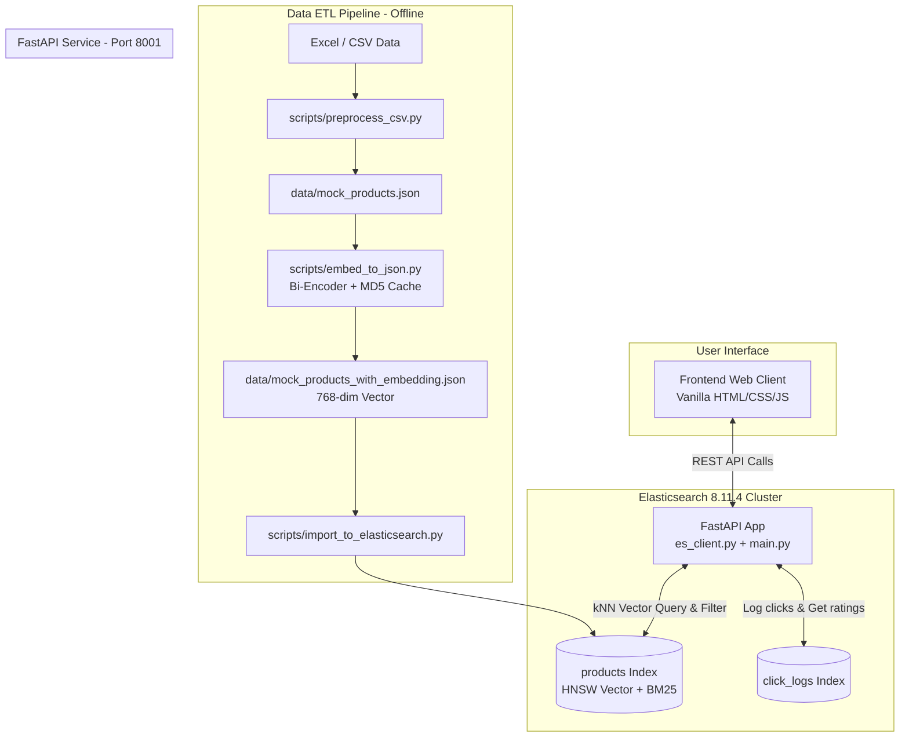

# 🧠 DeepSuggest - Hệ Thống Tìm Kiếm Ngữ Nghĩa & Gợi Ý Sản Phẩm Thông Minh

<p align="center">
  
  
  
  
  
  
</p>

> **DeepSuggest** là hệ thống tìm kiếm và gợi ý sản phẩm dựa trên nội dung (**Content-Based Recommendation**) và tìm kiếm ngữ nghĩa (**Semantic Search**) ứng dụng công nghệ **Vector Embedding (Dense Vectors)** và **kNN Search trên Elasticsearch 8.x**, kết hợp bộ lọc trích xuất khoảng giá tự nhiên bằng NLP/Regex.

---

## 📑 Mục Lục
- [🌟 Tính Năng Nổi Bật](#-tính-năng-nổi-bật)
- [🏛️ Kiến Trúc Hệ Thống](#️-kiến-trúc-hệ-thống)
- [📁 Cấu Trúc Thư Mục](#-cấu-trúc-thư-mục)
- [🚀 Hướng Dẫn Khởi Chạy Nhanh (Quick Start)](#-hướng-dẫn-khởi-chạy-nhanh-quick-start)
- [🤖 Sử Dụng Orchestrator (run_all.py)](#-sử-dụng-orchestrator-run_allpy)
- [🔌 Đặc Tả API Endpoints](#-đặc-tả-api-endpoints)
- [💻 Công Nghệ Sử Dụng](#-công-nghệ-sử-dụng)
- [📚 Tài Liệu Kỹ Thuật Bổ Sung](#-tài-liệu-kỹ-thuật-bổ-sung)

---

## 🌟 Tính Năng Nổi Bật

* **🔍 Tìm kiếm kép (Hybrid Search):**
  * **Keyword Search (BM25):** Tìm kiếm truyền thống với boost điểm độ khớp theo tên và mô tả sản phẩm.
  * **Semantic Suggestions (Vector kNN):** Tìm kiếm theo ngữ nghĩa thực tế, hiểu ý định của người dùng ngay cả khi không trùng từ khóa chính xác.
* **🧠 Mô hình Embedding tiếng Việt chuyên dụng:**
  * Tích hợp mô hình `bkai-foundation-models/vietnamese-bi-encoder` ánh xạ văn bản sản phẩm thành dense vector **768 chiều**.
  * Thuật toán chỉ mục HNSW (`cosine` similarity) trên Elasticsearch cho tốc độ phản hồi tính bằng mili-giây.
* **💰 Bộ lọc giá bằng Ngôn ngữ Tự nhiên (Natural Language Price Filtering):**
  * Nhận diện và bóc tách khoảng giá tự động từ câu truy vấn (ví dụ: *"laptop dưới 15 triệu"*, *"điện thoại 5-10 triệu"*, *"tai nghe trên 2 triệu"*).
* **🎯 Gợi ý sản phẩm tương tự (Content-Based Recommendation):**
  * Khi người dùng xem một sản phẩm, hệ thống tự động tính khoảng cách vector cosine và đề xuất **Top 5 sản phẩm tương đồng nhất**, loại trừ chính sản phẩm đang xem.
* **📊 Đánh giá sao động (Dynamic Click-Based Rating):**
  * Tự động lưu vết sự kiện người dùng click (`click_logs` index) và tính toán điểm rating thực tế cùng số sao hiển thị tương ứng.
* **⚡ Cơ chế MD5 Cache thông minh:**
  * Khi bổ sung dữ liệu mới, hệ thống tự động băm MD5 các trường của sản phẩm và chỉ tạo vector cho sản phẩm mới/sản phẩm có thay đổi, tránh tính toán lại lãng phí tài nguyên.
* **🐳 Docker hóa tối ưu (Lightweight CPU Image):**
  * Backend image sử dụng PyTorch CPU wheel chuyên biệt giúp giảm dung lượng image hơn 1.5GB và build siêu tốc.

---

## 🏛️ Kiến Trúc Hệ Thống



---

## 📁 Cấu Trúc Thư Mục

```bash
DeepSuggest_Elasticsearch/
├── 📁 backend/                  # Mã nguồn FastAPI service
│   ├── 📁 app/
│   │   ├── __init__.py
│   │   ├── es_client.py         # Elasticsearch client, kNN search & logic giá
│   │   └── main.py              # Định nghĩa API routes và CORS
│   ├── Dockerfile               # Docker image tối ưu PyTorch CPU
│   └── requirements.txt         # Thư viện cho backend
├── 📁 data/                     # Dữ liệu sản phẩm & vector embedding
│   ├── mock_products.json       # Dữ liệu sản phẩm sau làm sạch
│   ├── mock_products_with_embedding.json # Dữ liệu sản phẩm kèm 768-dim vectors
│   ├── raw_products.xlsx        # File dữ liệu tổng thô
│   └── raw_products_clean.xlsx  # File dữ liệu chuẩn hóa
├── 📁 docs/                     # Tài liệu kỹ thuật dự án
│   └── PRICE_FILTERING_LOGIC.md # Chi tiết logic phân tích regex lọc giá
├── 📁 frontend/                 # Giao diện người dùng Web
│   ├── index.html               # Trang hiển thị và thanh tìm kiếm
│   ├── style.css                # Giao diện responsive hiện đại
│   └── app.js                   # Logic gọi API, render cards & modal gợi ý
├── 📁 imgs/                     # Hình ảnh minh họa kiến trúc
├── 📁 notebook-preprocess/      # Jupyter Notebooks cào và phân tích data
│   ├── preprocess_for_all.ipynb
│   ├── read_data.ipynb
│   └── requirements.txt
├── 📁 scripts/                  # Data ETL pipeline offline
│   ├── embed_to_json.py         # Sinh vector embedding bằng SentenceTransformer
│   ├── evaluate_similarity.py   # Đánh giá độ tương đồng vector
│   ├── import_to_elasticsearch.py # Tạo index HNSW và nạp bulk data vào ES
│   ├── preprocess_csv.py        # Tiền xử lý, chuẩn hóa UTF-8
│   └── requirements.txt
├── .env.example                 # Mẫu cấu hình môi trường chuẩn
├── .gitignore                   # Cấu hình lọc file rác / nhạy cảm
├── docker-compose.yml           # Khởi chạy Elasticsearch, Kibana, Backend
├── run_all.py                   # Script tự động hóa toàn bộ quy trình
└── README.md                    # Tài liệu hướng dẫn sử dụng
```

---

## 🚀 Hướng Dẫn Khởi Chạy Nhanh (Quick Start)

### Yêu Cầu Hệ Thống
- **Docker Desktop** (bắt buộc phải đang khởi động).
- **Python 3.10+** (nếu muốn chạy các script import trên máy host).

---

### Bước 1: Chuẩn bị cấu hình môi trường
Tạo file `.env` tại thư mục gốc từ mẫu `.env.example`:
```bash
# Windows PowerShell:
Copy-Item .env.example .env

# macOS / Linux:
cp .env.example .env
```

### Bước 2: Khởi động hệ thống Docker
Khởi chạy cụm Elasticsearch 8.x, Kibana và Backend API:
```bash
docker-compose up -d
```
> *Lần đầu khởi chạy, Docker sẽ build image Backend và tải Elasticsearch. Vui lòng chờ 1-2 phút cho đến khi tất cả container đều `Healthy`/`Started`.*

### Bước 3: Nạp dữ liệu vào Elasticsearch
Dự án đã có sẵn dữ liệu và vector nhúng tại `data/mock_products_with_embedding.json`. Bạn chỉ cần cài thư viện client nhẹ và chạy script nạp:
```bash
pip install elasticsearch==8.11.1 python-dotenv
python scripts/import_to_elasticsearch.py
```
*Màn hình sẽ hiển thị thông báo nạp thành công **1,491 sản phẩm**.*

### Bước 4: Mở giao diện ứng dụng
- Mở trực tiếp file `frontend/index.html` bằng trình duyệt (hoặc dùng VS Code Live Server / lệnh `python -m http.server 3000 --directory frontend`).
- Trải nghiệm tìm kiếm sản phẩm, gợi ý tương đồng và bộ lọc giá!

---

## 🤖 Sử Dụng Orchestrator (`run_all.py`)

Nếu bạn muốn một lệnh duy nhất tự động kiểm tra, khởi động Docker, chạy pipeline và nạp dữ liệu:

```bash
python run_all.py
```

### Các Cờ Tùy Biến (Flags) Hữu Ích:
| Cờ lệnh | Ý nghĩa |
|---|---|
| `--skip-build` | Bỏ qua bước build image nếu image backend đã tồn tại |
| `--skip-preprocess` | Bỏ qua bước tiền xử lý Excel/CSV thô |
| `--skip-embed` | Bỏ qua bước tính toán vector embedding (dùng cache có sẵn) |
| `--force-embed` | Xóa cache và ép tạo lại toàn bộ vector embedding |
| `--no-docker` | Chỉ chạy data pipeline mà không can thiệp vào Docker |
| `--stop-after down` | Tự động tắt các container sau khi quy trình hoàn tất |
| `--prune-docker` | Tự động dọn dẹp các cache/image thừa của Docker |

---

## 🔌 Đặc Tả API Endpoints

FastAPI backend được cấu hình tại cổng **8001**:
* Tài liệu Swagger UI tương tác trực tiếp: 👉 `http://localhost:8001/docs`

| Phương Thức | Endpoint | Tham Số Truy Vấn | Mô Tả |
|:---:|---|---|---|
| `GET` | `/products` | `page`, `size`, `category` | Phân trang danh sách sản phẩm kèm số lượt đánh giá |
| `GET` | `/categories` | *(Không)* | Danh sách các danh mục sản phẩm duy nhất |
| `GET` | `/search-keyword` | `query`, `category`, `price_min`, `price_max` | Tìm kiếm theo từ khóa kết hợp tự động bóc tách khoảng giá |
| `GET` | `/search-semantic-suggestions` | `query`, `category` | Gợi ý sản phẩm theo ngữ nghĩa câu truy vấn bằng vector kNN |
| `GET` | `/recommend/{product_doc_id}` | `product_doc_id` *(path)* | Trả về thông tin sản phẩm và **Top 5 sản phẩm tương đồng nhất** |
| `POST` | `/log-click` | `{ "product_id": "string" }` | Ghi nhận sự kiện click của người dùng để cập nhật rating |

---

## 💻 Công Nghệ Sử Dụng

| Thành Phần | Công Nghệ / Thư Viện | Vai Trò |
|---|---|---|
| **Search Engine** | [Elasticsearch 8.11.4](https://www.elastic.co/) | Lưu trữ inverted index, Dense Vector HNSW kNN Search |
| **Backend** | [FastAPI](https://fastapi.tiangolo.com/), Uvicorn | Xây dựng RESTful API hiệu năng cao |
| **Embedding Model** | [BKAI Vietnamese Bi-Encoder](https://huggingface.co/bkai-foundation-models/vietnamese-bi-encoder) | Mô hình Transformer sinh vector 768 chiều cho tiếng Việt |
| **Deep Learning** | [PyTorch](https://pytorch.org/), [Sentence-Transformers](https://sbert.net/) | Tải mô hình và mã hóa vector embedding |
| **Data Processing** | Pandas, OpenpyXL, NumPy | Tiền xử lý, lọc nhiễu và làm sạch dữ liệu |
| **Frontend** | HTML5, CSS3 Modern, Vanilla JavaScript | Giao diện responsive, live search, dynamic modal |
| **Containerization** | Docker, Docker Compose | Đóng gói và cô lập môi trường chạy ứng dụng |

---

## 📚 Tài Liệu Kỹ Thuật Bổ Sung

* 💰 **[Logic Nhận Diện & Trích Xuất Bộ Lọc Giá (docs/PRICE_FILTERING_LOGIC.md)](docs/PRICE_FILTERING_LOGIC.md):** Giải thích chi tiết các mẫu biểu thức chính quy (Regex) dùng để nhận diện các dạng phát biểu giá tiền trong tiếng Việt.

---

## 🛠️ Lệnh Tiện Ích

**1. Kiểm tra trạng thái Elasticsearch:**
```bash
curl http://localhost:9200/_cluster/health?pretty
```

**2. Xóa index để nạp lại dữ liệu sạch:**
```bash
docker-compose exec elasticsearch curl -X DELETE "localhost:9200/products,click_logs"
```

**3. Xem log thời gian thực của backend:**
```bash
docker-compose logs -f backend
```

---

<p align="center">
  Phát triển với ❤️ cho bài toán tìm kiếm ngữ nghĩa và gợi ý sản phẩm tiếng Việt.
</p>